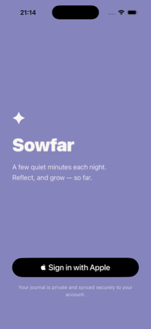
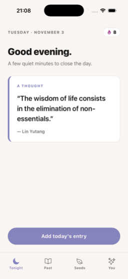
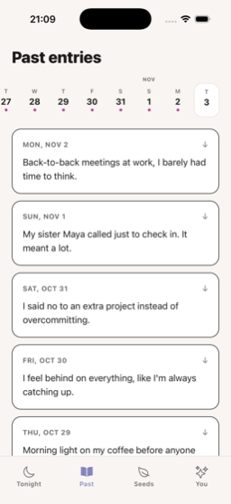
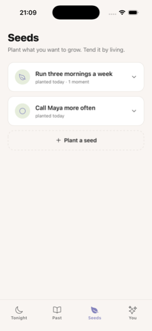

# Sowfar

A few quiet minutes each night. Sowfar is an iOS journaling app: two short prompts, an optional follow-up, a free write, and a gentle reframe. Over time it notices patterns and helps you tend the things you want to grow.

Everything you write is encrypted on your phone before it is saved. The server only ever holds ciphertext.

## Screenshots

<p align="center">
  
  
  
  
  
</p>

## Features

- **Tonight.** A daily thought, a streak counter, and a guided entry: two prompts, a follow-up question generated from your answers, a free write, and a short reframe.
- **Past.** A scrollable week strip and every entry you have written. Entries from today and yesterday stay editable.
- **Seeds.** Plant up to three intentions. The app checks in weekly and keeps a timeline of small moments of movement.
- **You.** Your streak and, once there are enough entries, a handful of patterns the app has noticed about you, refreshed weekly.
- **Weekly summary.** A short recap of the previous week, shown on the first entry of a new one.
- **Evening reminder.** A local notification at 8 pm.

## How it works

- **Client.** Expo SDK 57, React Native, Expo Router, TypeScript.
- **Auth and storage.** Supabase with Sign in with Apple. Three tables: entries, seeds, and weekly summaries. Each row's content column is an encrypted blob; only the date and user id are in the clear.
- **Encryption.** A random journal key encrypts every entry with NaCl secretbox. The key is wrapped with a password-derived key (scrypt) and stored server-side, so the password never leaves the device and the server cannot read anything. A recovery code wraps a second copy of the key.
- **AI.** Claude generates the follow-up question, the reframe, the weekly summary, and the patterns on the You tab. Decrypted text is sent only for those calls and is never stored by the app's backend.

## Running it

Sign in with Apple and secure storage need native modules, so the app runs as a development build rather than in Expo Go.

```
cp .env.example .env     # fill in Supabase URL, Supabase key, and Anthropic key
npm install
npx expo run:ios         # builds the native project and launches the simulator
```

For a physical device, build a development client once with `eas build --profile development --platform ios`, then run `npx expo start --dev-client` and open the app.

Sign in with Apple does not work in the simulator without an Apple ID signed into the simulator and a real team identifier, so test the sign-in flow on a device.

## Project layout

```
app/            screens (Expo Router): login, vault setup, vault unlock, edit, and the four tabs
services/       Supabase client, encryption, vault, entries, seeds, insights, Claude, notifications
constants/      colors, prompts, quotes, dev sample data
types/          shared TypeScript types
docs/           README screenshots
```
